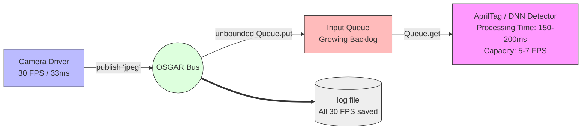
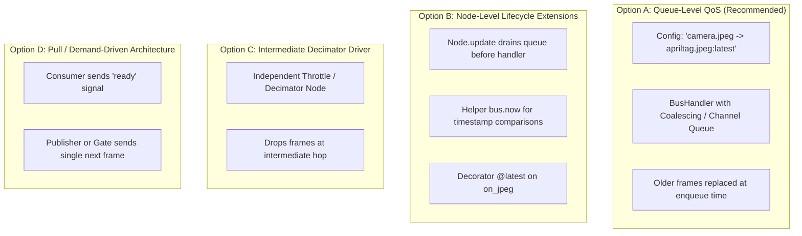
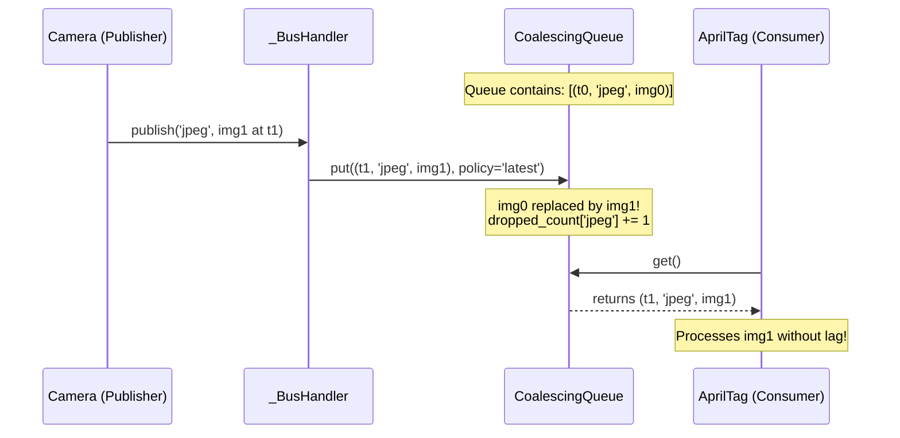

# Processing Latest Messages & Dropping Stale Data in OSGAR

## Architecture Review, Trade-Off Analysis, and Implementation Specification

---

## 1. Executive Summary & Problem Statement

### 1.1 The Core Guarantee of OSGAR
The foundational design tenet of the OSGAR framework is **complete, lossless recording and delivery**:
* Every message published on a registered channel is immediately written to the log file via `LogWriter` (unless explicitly silenced with the `:null` modifier).
* In the single-process runtime (`osgar.record`), every message is pushed to the input queue of every linked consumer via `_BusHandler.out[channel]`:
  ```python
  for queue, input_channel in self.out[channel]:
      queue.put((timestamp, input_channel, data))
  ```
* This FIFO queue is currently an unbounded Python `queue.Queue()`.
* In log replay (`osgar.replay`), all logged records are delivered sequentially to the replayed node to verify deterministic reproducibility.

### 1.2 The Bottleneck with Slow Perception Nodes
While lossless delivery is vital for sensor telemetry (odometry, IMU, CAN bus frames, battery state, commands), it presents a severe structural obstacle for **heavy perception and computer vision pipelines**:



Consider a camera publishing JPEG frames at **30 FPS (one frame every 33 ms)** connected to a vision node such as `osgar.proc.apriltag.AprilTag` running on CPU where marker detection requires **150 ms to 200 ms per image**:
1. **Unbounded Queue Growth:** For every frame processed, 5 to 6 new frames accumulate in the consumer's `queue.Queue`.
2. **Compounding Latency (Stale Data):** The detector is permanently consuming obsolete images from the head of the FIFO queue. After 10 seconds of operation, the detector is processing images that were captured several seconds in the past. For robot navigation and control, acting on stale poses leads to oscillations, missed waypoints, or collisions.
3. **Memory Exhaustion:** High-resolution images or 3D point clouds buffered in memory cause large memory footprints and garbage collection pressure.
4. **False-Positive Failure Alerts:** `_BusHandler.publish()` enforces `ASSERT_QUEUE_DELAY = timedelta(seconds=.1)`. Because the queue delay continuously increases, the bus repeatedly triggers `report_error(delay=...)` to stream 0 and logs severe delay warnings upon system exit:
   ```text
   apriltag: maximum delay of 0:00:14.321000 at 0:00:15.100000
   ```

### 1.3 The Goal
For perception nodes, the application only cares about the **freshest available image at the moment the worker is ready to compute**. Intermediate, unprocessed images should be skipped (dropped) by that specific consumer, while:
* The original sensor stream is still logged at the full frame rate.
* Other consumers (e.g., video recorders or fast feature trackers) continue receiving all frames.
* The number of dropped images is tracked and logged for offline performance and throughput analysis.
* The solution is cleanly integrated into the framework rather than requiring repetitive, error-prone boilerplate in every user driver.

---

## 2. Review of Historical Solutions (The DARPA SubT Experience)

During the DARPA Subterranean Challenge (SubT), several perception nodes encountered this exact issue (e.g., in `_deprecated/subt/artifacts.py`, `_deprecated/subt/artf_node.py`, `_deprecated/subt/bundle_rgbd.py`, and `_deprecated/subt/jetson_artf_node.py`).

### 2.1 The Timestamp Draining Pattern
To drop stale images without violating OSGAR's strict rule prohibiting system time (`time.time()`), developers implemented a custom loop utilizing the timestamp returned by `publish()`:

```python
# Historical SubT Pattern from subt/artifacts.py
def run(self):
    try:
        dropped = 0
        while True:
            # 1. Publish dropped count; logger.write() returns the current bus timestamp
            now = self.publish("dropped", dropped)
            dropped = -1
            timestamp = now

            # 2. Drain all queued messages whose timestamp is <= now
            while timestamp <= now:
                timestamp = self.waitForImage()
                dropped += 1

            # 3. Process the first message whose timestamp is > now
            self.detect(self.image)
    except BusShutdownException:
        pass
```

### 2.2 Why This Worked
1. **Monotonic Bus Clock Access:** In OSGAR, `bus.publish()` calls `logger.write()`, which computes the exact run time delta (`now = datetime.datetime.now() - self.start_time`). By publishing a lightweight `"dropped"` stream, the node acquired the current timestamp without violating framework rules.
2. **Determinism in Log Replay:** Because `"dropped"` was an officially registered output stream written to the log, during replay with `LogBusHandler`, `publish("dropped", dropped)` synchronized with the recorded log record. All camera frames recorded between outputs were placed into `LogBusHandler.buffer_queue` with timestamps `<= now`, and were drained deterministically in replay just as they were during the live run.

### 2.3 Limitations & Architectural Flaws of the Historical Pattern
Despite solving the immediate problem during the competition, this pattern exhibits several serious drawbacks that make it unsuitable as a general framework standard:

| Defect | Description | Impact |
| :--- | :--- | :--- |
| **Artificial Stream Requirement** | Forces the node to register and publish a synthetic `"dropped"` stream solely to query current time. | Pollutes log files and channel registries with plumbing streams. |
| **Latency Penalty (Over-Dropping)** | The condition `timestamp <= now` drops all images queued *up to* the moment processing finished and **forces the thread to block** until a subsequent image arrives (`timestamp > now`). | Injects an unnecessary full frame-period of latency (~33–100ms) even if a fresh image arrived 1ms before `now`. |
| **Bypasses Standard `Node` Lifecycle** | Completely breaks `Node.update()` and the idiomatic `on_<channel>()` handler dispatch. | Drivers must write custom, repetitive `run()` and `waitForData()` loops (~30 lines of boilerplate per driver). |
| **Multi-Channel Starvation & Hazards** | Draining `self.bus.queue` discards *all* intervening packets on that queue. If the node also subscribes to `pose3d`, `scan`, or `emergency_stop`, those packets are either lost or require complex manual dispatch logic in `waitForData()`. | High risk of state desynchronization or losing critical lower-frequency control messages. |
| **Queue & Memory Churn** | Images are still serialized, queued into Python's `Queue`, dequeued, and deserialized, only to be thrown away in user code. | Wasted CPU cycles and memory bandwidth on packets destined for the trash. |

---

## 3. Architectural Design Options

Four architectural tiers were evaluated to determine how OSGAR can natively support "latest-message" semantics:



### Option A: Bus / Queue-Level QoS Coalescing (Recommended)
* **Mechanics:** Replace or augment the unbounded FIFO `Queue` in `_BusHandler` with a **channel-aware coalescing queue**. Channels can be flagged with a QoS policy: `FIFO` (default) or `LATEST` (queue depth = 1).
* **Behavior:** When `publish()` routes data to a consumer's queue:
  - If the target channel is `FIFO`, it is appended normally.
  - If the target channel is `LATEST`, any unread message on that channel currently sitting in the queue is evicted and replaced with the new message. An internal dropped-counter is incremented.
* **Multi-Channel Safety:** Messages on other channels (e.g., `cmd`, `pose`) remain in the queue in strict chronological order and are never evicted.
* **Driver Impact:** Zero changes required inside driver code (`AprilTag` uses standard `on_jpeg`).

### Option B: Node-Level Helper API (`Node.drain_stale()`)
* **Mechanics:** The bus continues delivering all messages into `self.queue`. `osgar.node.Node` provides framework methods or a handler decorator `@latest`:
  ```python
  class AprilTag(Node):
      @latest
      def on_jpeg(self, data):
          ...
  ```
  Inside `Node.update()`, before invoking `on_jpeg`, the node inspects `self.bus.queue` and flushes all pending `jpeg` messages, incrementing a framework-managed counter.
* **Driver Impact:** Minimal, but images still experience full queue churn and heap allocation before being drained.

### Option C: Intermediate Throttling / Decimator Driver
* **Mechanics:** Introduce a standalone driver `osgar.drivers.throttle:Throttle` in `config.json` between the camera and the detector.
* **Drawback:** Fixed-rate downsampling (e.g., 30 FPS to 5 FPS) is inefficient when processing time varies dynamically (e.g., detecting 0 tags takes 20ms, detecting 10 tags takes 250ms). A static rate either starves the detector or still causes lag.

### Option D: Demand-Driven (Pull / Request-Response)
* **Mechanics:** The detector publishes a `ready` signal. An upstream gate or camera node only forwards the next frame when `ready` is received.
* **Drawback:** Inverts OSGAR's clean push-based pub/sub paradigm; adds network/IPC round-trip latency; requires custom upstream logic.

### Comparison Matrix

| Evaluation Criterion | Option A: Bus Queue QoS | Option B: Node Drain | Option C: Decimator Node | Option D: Pull Gate |
| :--- | :---: | :---: | :---: | :---: |
| **Transparency to Driver Code** | **Excellent (Zero changes)** | Good (Decorator/method) | Fair (Config plumbing) | Poor (Protocol redesign) |
| **Memory & Heap Efficiency** | **Optimal (Evicts immediately)** | Moderate (Evicts on update) | Good | Good |
| **Multi-Channel Order Safety** | **Guaranteed** | Moderate (Complex drain) | Guaranteed | Fair |
| **Dynamic Workload Adaptation**| **Self-tuning to consumer speed** | **Self-tuning** | Poor (Fixed rate) | **Self-tuning** |
| **Replay Compatibility** | **High** | High | High | Low |
| **ZMQ Router Parity** | **Straightforward** | N/A (Node-only) | Straightforward | Complex |

---

## 4. Proposed Architecture & Specification

The recommended solution combines **Config-Driven Channel Modifiers (Option A)** with **Framework-Managed Telemetry** and **Clean Replay Semantics**.

### 4.1 Configuration Syntax: `:latest` Input Modifier

In OSGAR, output modifiers already exist for functional channel overrides (`:gz`, `:null`, `:`). We extend this paradigm to **input links** in `config.json`:

```json
{
  "modules": {
    "camera": {
      "driver": "osgar.drivers.opencv:OpenCVCamera",
      "init": { "id": 0 }
    },
    "apriltag": {
      "driver": "osgar.proc.apriltag:AprilTag",
      "init": { "type": "25h9" },
      "in": ["jpeg:latest"]
    }
  },
  "links": [
    ["camera.jpeg", "apriltag.jpeg:latest"]
  ]
}
```

* Syntax rules:
  * `receiver.channel:latest` sets the queue policy for that input channel to **depth = 1** (coalescing).
  * `receiver.channel` (default without suffix) preserves standard **lossless FIFO** behavior.
  * Optionally, `:depth=N` can be supported for bounded FIFO windows.

### 4.2 Bus Handler & Queue Implementation

#### The `CoalescingQueue` Data Structure
Instead of a standard `queue.Queue()`, `_BusHandler` uses a thread-safe `CoalescingQueue`:



#### Detailed Data Structure Mechanics:
1. `CoalescingQueue` wraps an internal `collections.deque` and a lock/condition variable.
2. For channels configured as `:latest`, the queue tracks the index or reference of any unconsumed item for that channel.
3. When `put()` is called for a `:latest` channel:
   - If an item for that channel is already pending in the queue, its payload and timestamp are updated in-place (or the older entry is removed and the newer appended), and `dropped_count[channel]` is incremented.
   - If no item for that channel is pending, it is appended to the queue normally.
4. When `get()` is called by the consumer (`listen()`), items are returned in the order they arrived, ensuring that non-coalesced channels (e.g., `cmd`) maintain proper chronological interleaved order.

### 4.3 Dropped Message Telemetry & Logging

Tracking dropped frames is essential for performance analysis (e.g., measuring whether a Jetson GPU is maintaining acceptable frame rates compared to an Intel CPU).

The framework provides three telemetry mechanisms:

#### 1. Automatic Telemetry Output Stream
If any input channel on a node uses `:latest`, `_BusHandler` can automatically register an internal telemetry stream: `<module>.dropped`:
* **Published Data:** A dictionary containing:
  ```python
  {
      "channel": "jpeg",
      "dropped": 5,        # Dropped since last processed packet
      "total_dropped": 42, # Cumulative dropped
      "delay": 0.182       # Duration of last processing cycle in seconds
  }
  ```
* **Timing:** Published automatically by the bus handler immediately before returning the fresh packet from `listen()`, or published periodically (e.g., at 1 Hz).

#### 2. Suppression of False-Positive `ASSERT_QUEUE_DELAY`
Currently, `_BusHandler.publish()` logs an error if `delay > ASSERT_QUEUE_DELAY (0.1s)`:
```python
if delay > ASSERT_QUEUE_DELAY:
    caller = inspect.currentframe().f_back.f_code.co_name
    self.report_error(delay=delay.total_seconds(), channel=channel, caller=caller)
```
For channels deliberately marked `:latest`, large delays between input arrivals and publishing are expected and normal. The framework should:
* Suppress the generic `ASSERT_QUEUE_DELAY` error for nodes whose inputs are marked `:latest`.
* Instead log dropped frame metrics to stream 0.

#### 3. Execution Summary Reporting
Upon session exit in `Recorder.__exit__`, report dropped frame statistics alongside queue delays:
```text
   apriltag: processed 124 frames, dropped 618 frames (83.3% dropped, effective 5.8 FPS)
```

### 4.4 Node-Level Ergonomics (`bus.now()`)
To eliminate the need for nodes to call `self.publish()` just to inspect current time, `_BusHandler` and `LogBusHandler` should expose:
```python
def now(self):
    """Return the current monotonic framework time."""
    if self.logger is not None:
        return datetime.datetime.now(datetime.timezone.utc) - self.logger.start_time
    return self._time or timedelta()
```
This allows nodes that perform internal timeout tracking or state estimation to query the clock cleanly.

### 4.5 ZeroMQ Parity (`osgar/zmqrouter.py`)

In multi-process deployments (`zmqrouter.py`):
1. In `_Router.connect(link_from, link_to)`: Parse the `:latest` modifier from `link_to`.
2. In `_Router.send(node_name, action, dt, *args)`:
   - `self.nodes[node_name]` is a `collections.deque()`.
   - If the channel is marked `:latest` and a packet for that channel is already queued in `self.nodes[node_name]`, replace the older packet and increment `self.dropped[node_name][channel]`.
   - When the worker sends a `listen` request, it immediately receives the freshest packet.

---

## 5. Replay, Simulation, and Determinism

A core strength of OSGAR is perfect replayability. How does frame dropping behave when replaying a log?

### 5.1 Replay Scenarios

| Scenario | Objective | Desired Behavior |
| :--- | :--- | :--- |
| **Scenario 1: Live Simulation Replay** | Reproduce the exact behavior of the live robot mission for bug investigations. | The replay should drop the **exact same frames** that were dropped during the mission. |
| **Scenario 2: Offline Reprocessing (`--force`)** | Run an updated detector (e.g. improved AprilTag algorithm or new model weights) on recorded data to maximize detection accuracy. | The detector should process **every single frame** recorded in the log, regardless of how long processing takes. |

### 5.2 Supporting Both Modes Cleanly
1. **Offline Reprocessing (Default for `osgar.replay -F`)**:
   - In offline replay, time is decoupled from wall-clock CPU speed.
   - `LogBusHandlerInputsOnly` delivers all logged frames sequentially. The detector evaluates all frames without dropping any, allowing full evaluation on the dataset.
2. **Deterministic Live-Replay (Verification Mode)**:
   - When verifying recorded outputs against live outputs with `LogBusHandler`:
     Because the log contains the timestamps of both the raw camera frames and the output messages (or `<module>.dropped` records), `LogBusHandler` discards buffered frames whose timestamps precede the recorded output timestamp.
   - This guarantees that verification mode remains 100% deterministic, independent of whether the replay machine is faster or slower than the robot's onboard computer.

---

## 6. Migration Example: Before & After

### Current Driver (`osgar/proc/apriltag.py`)
```python
class AprilTag(Node):
    def __init__(self, config, bus):
        super().__init__(config, bus)
        bus.register('apriltags', 'targets')
        ...

    def on_jpeg(self, data):
        # Problem: If detect takes 200ms, incoming 30 FPS frames 
        # queue up indefinitely. Detection lags seconds behind real time!
        img = cv2.imdecode(np.frombuffer(data, np.uint8), cv2.IMREAD_COLOR)
        self.process_and_publish(img)
```

### With Framework Support (Zero Driver Boilerplate)
The driver code remains 100% standard and clean:
```python
class AprilTag(Node):
    def __init__(self, config, bus):
        super().__init__(config, bus)
        bus.register('apriltags', 'targets')
        ...

    def on_jpeg(self, data):
        # The framework guarantees data is ALWAYS the latest image!
        # Older images queued during previous execution were dropped automatically.
        img = cv2.imdecode(np.frombuffer(data, np.uint8), cv2.IMREAD_COLOR)
        self.process_and_publish(img)
```

Configuration in `config.json`:
```json
"links": [
  ["camera.jpeg", "apriltag.jpeg:latest"]
]
```

---

## 7. Actionable Implementation Hand-Off Plan

This phased plan outlines the specific tasks required to implement this feature in the codebase:

### Phase 1: Core Bus Queue Extensions (`osgar/bus.py`)
1. **Implement `CoalescingQueue`**:
   - Create a thread-safe queue class in `osgar/bus.py` supporting `set_channel_policy(channel, policy='latest')` and `get_dropped_count(channel)`.
   - Update `_BusHandler.__init__` to instantiate `self.queue = CoalescingQueue()`.
2. **Update Link Connection Logic**:
   - In `Bus.connect()` / `_BusHandler.connect()`, parse channel modifiers on the receiver input (e.g., `input_channel.split(':')`).
   - If modifier is `latest`, register the policy with the receiver's queue.
3. **Expose Monotonic Clock**:
   - Add `bus.now()` to `_BusHandler` and `LogBusHandler` returning current run `timedelta`.

### Phase 2: Configuration & Diagnostics (`osgar/record.py`)
1. **Update Config Parser**:
   - Ensure `config['links']` properly handles input modifier suffixes when verifying channel connections.
2. **Enhance Diagnostics & Exit Reporting**:
   - In `Recorder.__exit__`, collect and print dropped message metrics from all bus handles.
   - Suppress `ASSERT_QUEUE_DELAY` warnings on channels explicitly designated as `:latest`.

### Phase 3: ZMQ Router Parity (`osgar/zmqrouter.py`)
1. **Update `_Router`**:
   - In `_Router.connect()`, store per-channel QoS policies for subscriptions.
   - In `_Router.send()`, replace existing pending packets in `self.nodes[receiver]` if the channel policy is `latest`.

### Phase 4: Replay & Testing
1. **Unit Tests (`osgar/test_bus.py`, `osgar/test_node.py`)**:
   - Test single-channel queue replacement: publish 5 frames, verify consumer receives only the 5th frame, and dropped count equals 4.
   - Test multi-channel isolation: interleaved `image` (marked `:latest`) and `cmd` (marked `FIFO`). Verify all `cmd` messages are delivered in order while older `image` messages are dropped.
   - Test `bus.now()` accuracy.
2. **Documentation & Benchmarks**:
   - Update `doc/deep_dive.md` (Section 2 and Section 9) with `:latest` input modifier documentation.
   - Add a test configuration validating `AprilTag` with a high-rate camera stream.

---
*Document author: Gemini CLI Agent for OSGAR Core Development*  
*Target: OSGAR Framework Core Architecture*
